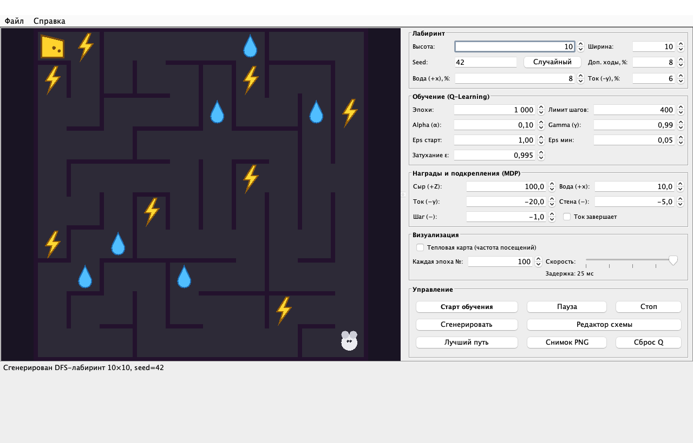
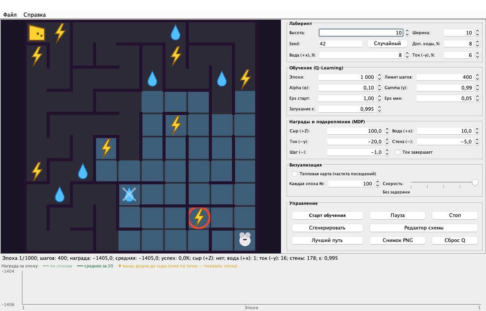
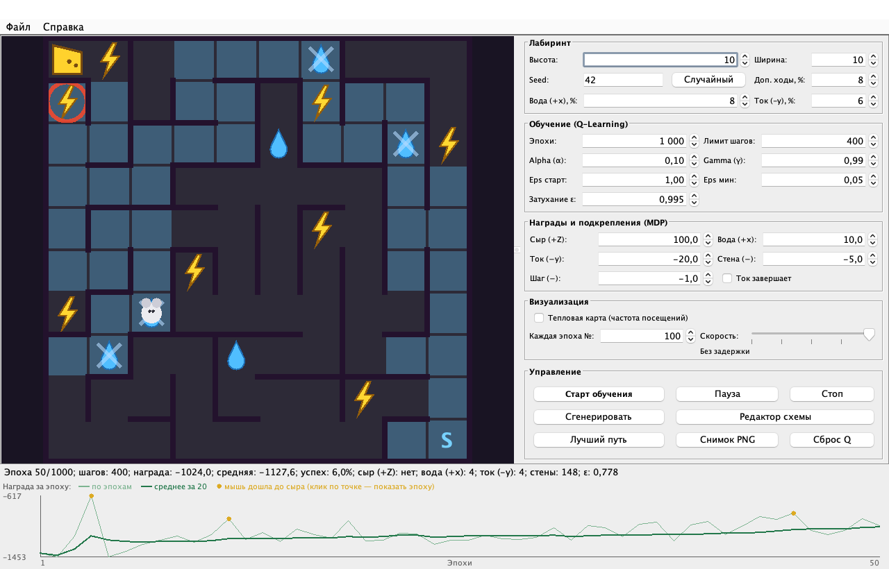
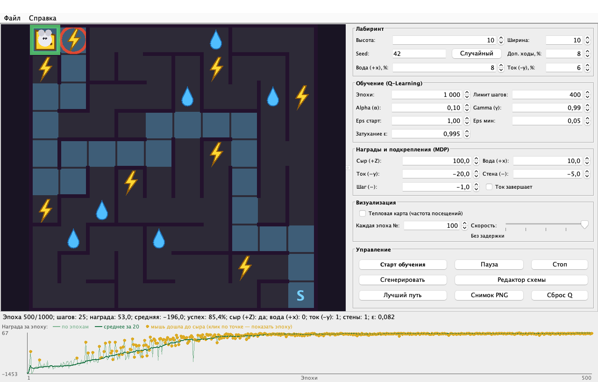
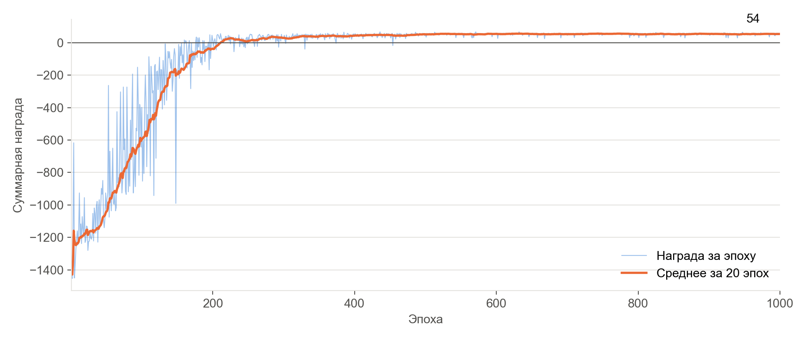
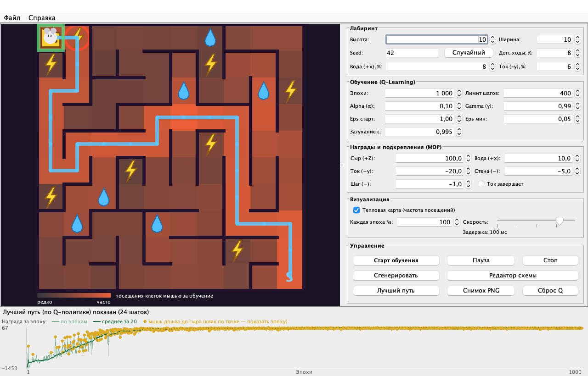

# Мышь в лабиринте — обучение с подкреплением (Q-learning)

Лабораторная работа № 2 по дисциплине «Объектно-ориентированное программирование на языке Java», СПбПУ.
Выполнил: Рыбалкин К. М., гр. 5130902/40204. Преподаватель: Хасанов Д. С.

Мышь ищет большой сыр (+Z) в конце лабиринта, по пути пьёт воду (+x) и избегает электротравмы (−y).
Заранее она ничего не знает: учится только по наградам, которые среда сообщает после каждого шага.



## Модель задачи

| Элемент MDP | В программе |
|---|---|
| Состояние | клетка мыши (x, y) |
| Действия | вверх, вниз, влево, вправо |
| Награды | сыр +100 (конец эпизода), вода +10 (один раз за эпизод), ток −20, шаг −1, стена −5 (мышь остаётся на месте) |

Обучение — табличный Q-learning с ε-жадным выбором действия:

```
Q(s, a) ← Q(s, a) + α · [ r + γ · max Q(s', a') − Q(s, a) ]
```

Лабиринт любого размера генерируется поиском в глубину (DFS) с возвратом. Схему можно нарисовать в
редакторе или загрузить из текстового файла (примеры — в папке `examples`).

## Запуск

Нужна Java 17+.

```bash
mvn package
java -jar target/mouse-maze-1.0-SNAPSHOT.jar
```

Тесты: `mvn test`.

## Структура

| Пакет | Назначение |
|---|---|
| `model` | лабиринт, координаты, действия, типы клеток, награды |
| `environment` | среда MDP: интерфейс `Environment`, реализация `MazeEnvironment` |
| `agent` | интерфейс `Agent`, `QLearningAgent`, Q-таблица |
| `generator` | генерация DFS, размещение воды и ловушек, загрузка и сохранение схем |
| `training` | цикл обучения `Trainer`, построение лучшего пути |
| `ui` | окно Swing: настройки, лабиринт, график, редактор схем |

## Результаты (лабиринт 10 × 10, seed 42, 1000 эпох)

| Эпоха 1 — случайное блуждание | Эпоха 50 — поиск пути | Эпоха 500 — путь к сыру |
|---|---|---|
|  |  |  |



За 1000 эпох мышь дошла до сыра в 927 эпизодах; начиная с 201-й эпохи — в каждом.
Средняя награда выросла с −914 (эпохи 1–100) до +54 (эпохи 901–1000),
лучший путь по выученной политике — 24 шага.


